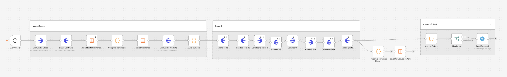
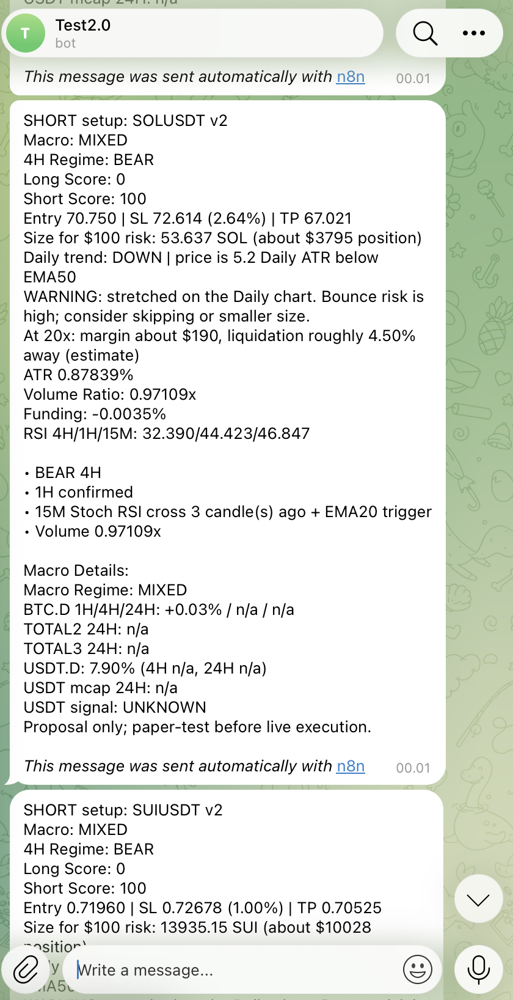

# 🤖 Tester Bot: Crypto Futures Analysis Agent (n8n + Telegram)

An automated AI agent built with **n8n** and **Telegram** that monitors and analyzes a curated watchlist of **20 cryptocurrencies** to surface actionable insights for **intraday and swing futures trading** using **Bitget** and **CoinGecko** data.

> ⚠️ **Disclaimer:** This project is for educational and technical showcase purposes only. It does not constitute financial, trading, or investment advice.

---

## 📸 Visual Demo

### n8n Workflow Architecture


### Telegram Interaction


---

## 🎯 What It Does
Manually tracking 20 different crypto pairs across multiple timeframes is time-consuming. **Tester Bot** automates the market research pipeline directly inside Telegram:

* **Curated Watchlist Tracking:** Continuously pulls live market and derivatives data for 20 selected high-liquidity crypto assets.
* **Intraday & Swing Analysis:** Evaluates market conditions tailored for both **intraday** (short-term momentum, volatility, and funding rate shifts) and **swing** (multi-day trend structure) futures setups.
* **On-Demand Telegram Reports:** Delivers structured, easy-to-read market breakdowns directly to a Telegram chat via commands or scheduled triggers.

---

## 🛠️ Tech Stack & Integrations
* **Orchestration:** [n8n](https://n8n.io) (Self-hosted / Cloud)
* **User Interface:** Telegram Bot API (`Telegram Trigger` & `Telegram` nodes)
* **Exchange Data:** [Bitget API](https://bitget.com) (USDT-M Futures tickers, funding rates, open interest, and candlestick/OHLCV data)
* **Market Data:** [CoinGecko API](https://coingecko.com) (Global market metrics, market cap rankings, and 24h volume)

---

## 📂 Repository Structure
```text
├── README.md
├── workflows/
│   └── tester-bot.json        # Exported n8n workflow (credentials sanitized)
├── tester-bot-workflow.png
└── tester-bot-demo.png
```

---

## 🚀 How to Import & Run

1. **Download the Workflow:** Grab `workflows/tester-bot.json` from this repository.
2. **Import into n8n:** Open your n8n canvas, click the **three dots (`...`)** in the top-right corner, and select **Import from File**.
3. **Configure Credentials:** Set up your own credentials inside n8n for:
   * **Telegram Bot API** (via `@BotFather`)
   * **Bitget API** (Read-only market data permissions only — no trading/withdrawal permissions needed)
   * **CoinGecko API** (Demo or Pro key)
4. **Customize Watchlist:** Open the watchlist node/array to adjust the 20 coin symbols (e.g., `BTCUSDT`, `ETHUSDT`, `SOLUSDT`) to your preferred Bitget futures pairs.
5. **Activate:** Toggle the workflow to **Active** and message your bot in Telegram.
